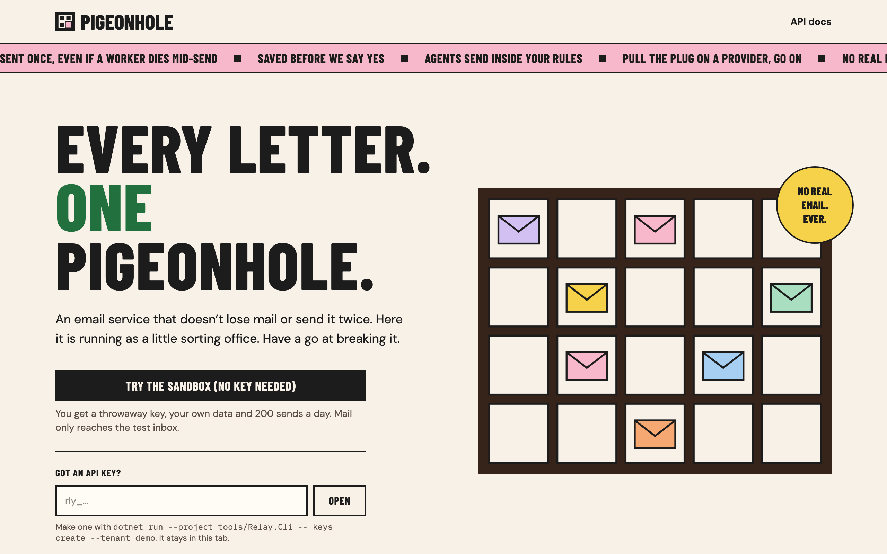
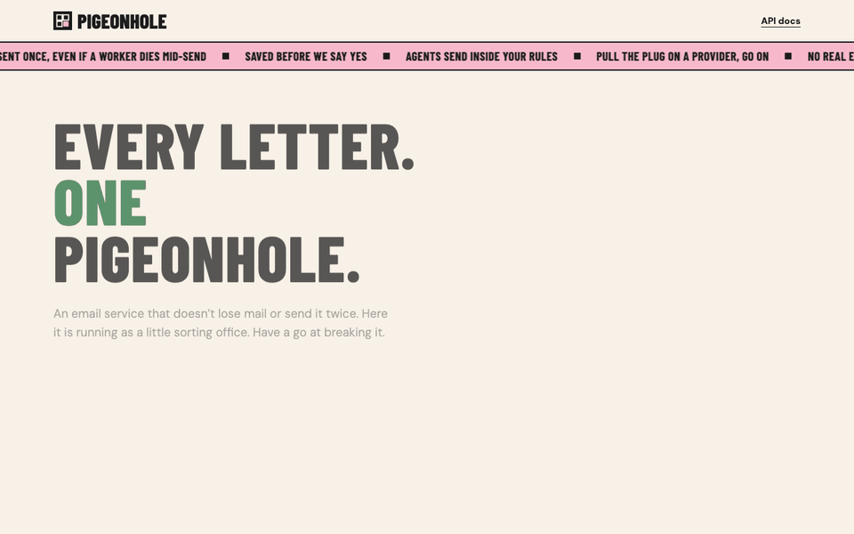
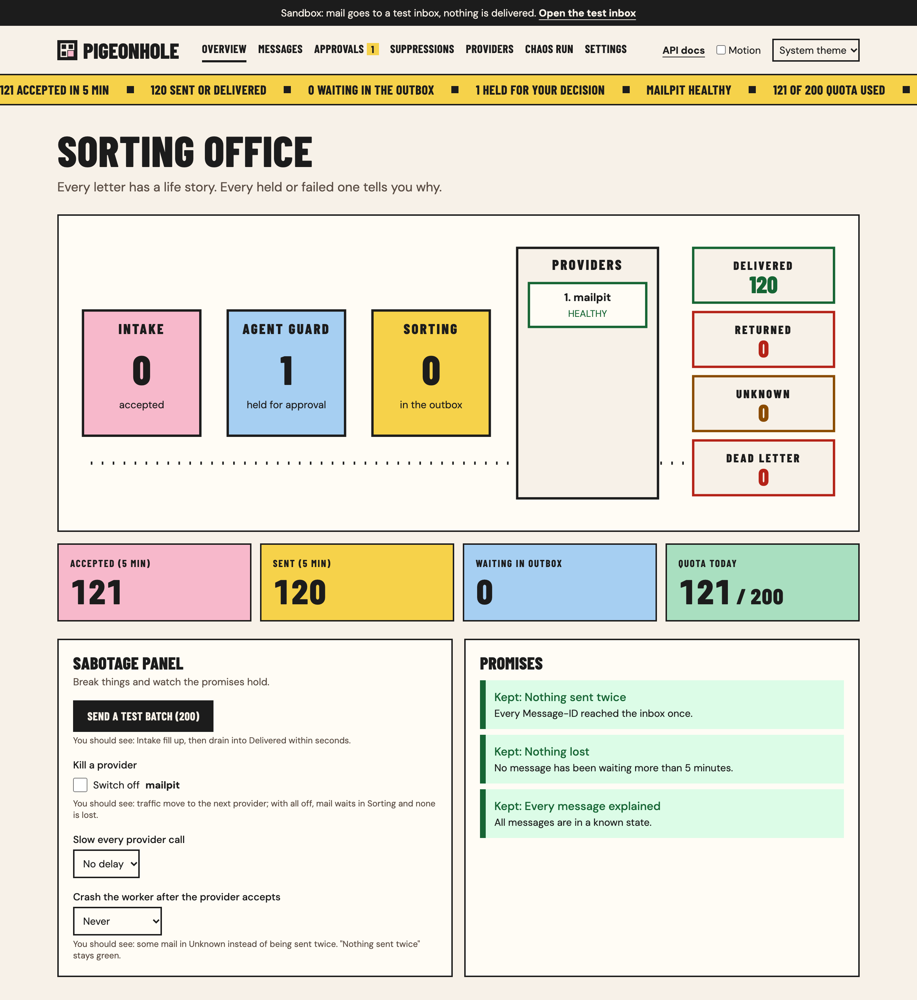
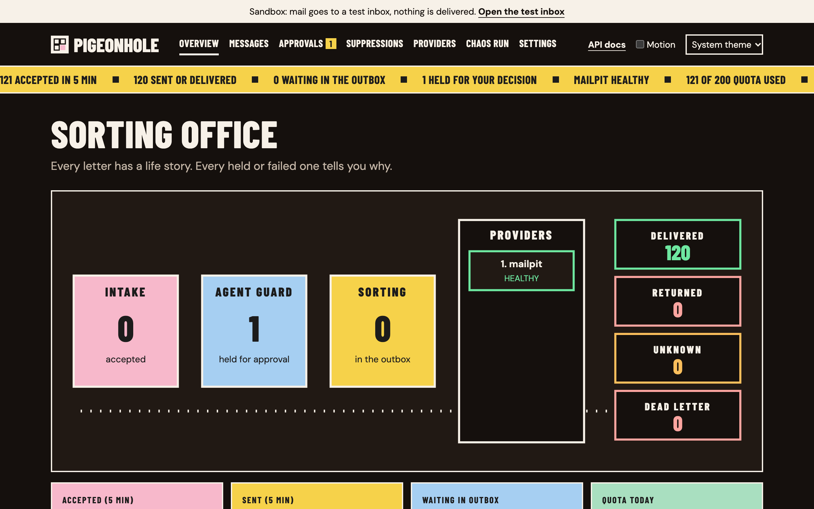
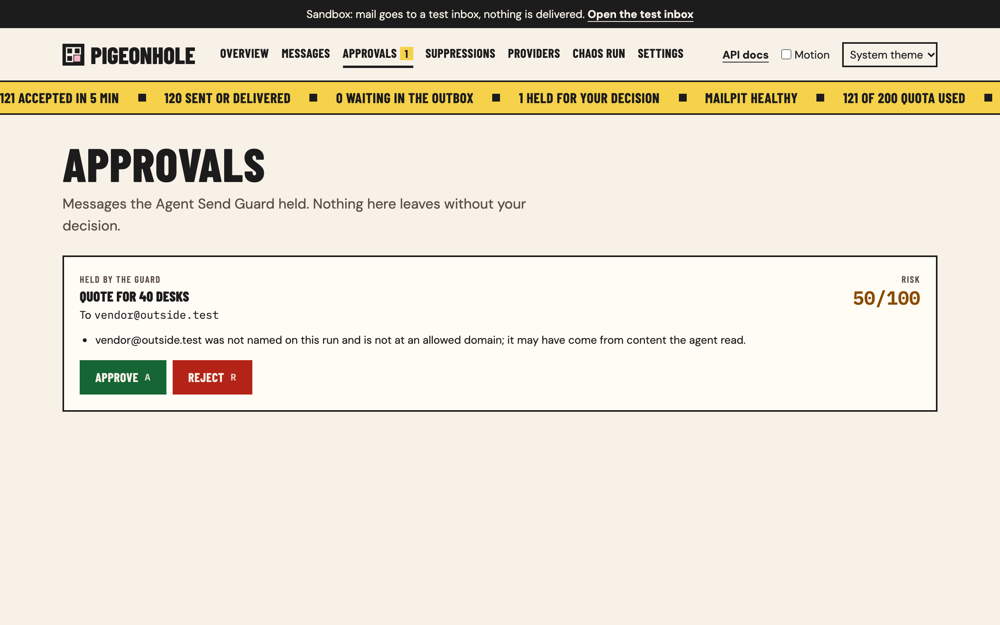
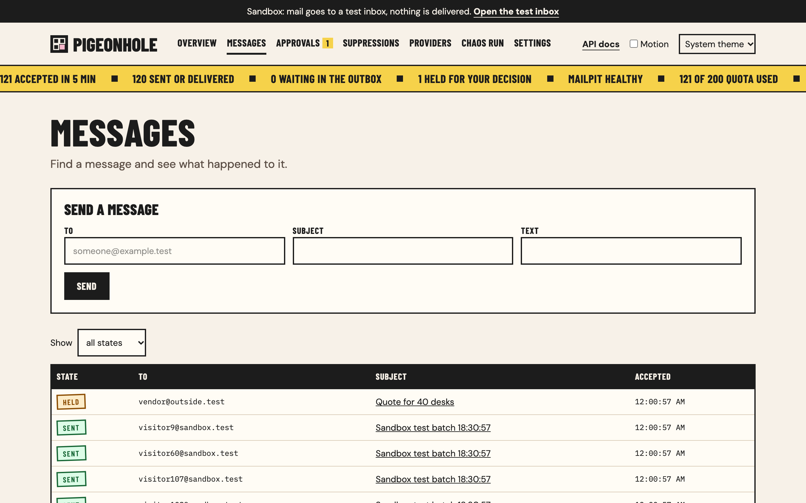
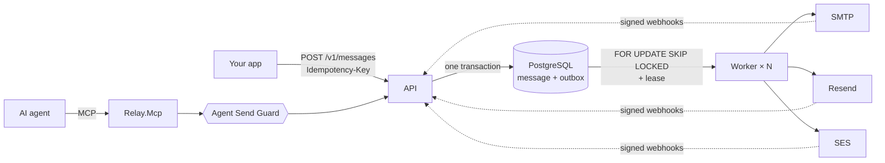
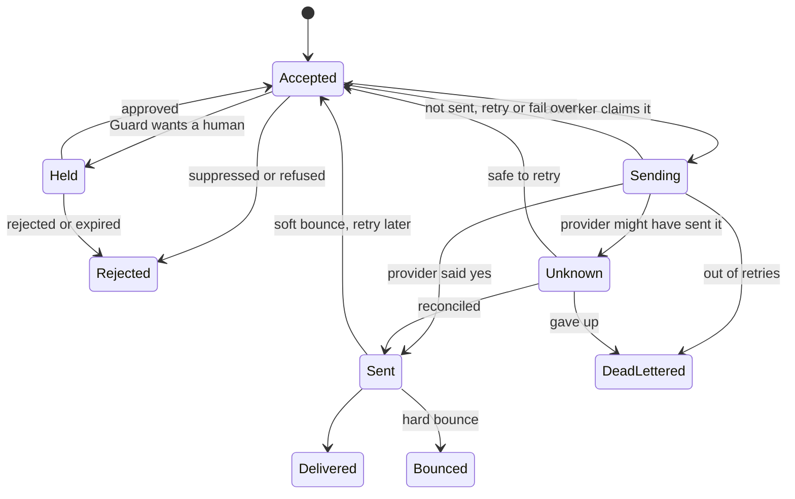

<p align="center">
  
</p>

<h1 align="center">Pigeonhole</h1>

<p align="center">
  <b>Email that arrives once. Not zero times, not twice. Once.</b><br>
  A delivery service for .NET, with a guard dog for AI agents that want to send mail.
</p>

<p align="center">
  <a href="https://github.com/azzs11/pigeonhole/actions/workflows/ci.yml"></a>
  <a href="https://github.com/azzs11/pigeonhole/releases"></a>
  <a href="LICENSE"></a>
</p>

---

## The problem, in three sentences

Email has no "exactly once": if your app crashes between *the provider said OK* and *we wrote
that down*, you either lose the message or send it again. Most code picks "send it again"
without noticing, and your customer gets two password resets. Put an AI agent on the send
button and it gets worse: agents retry, loop, and occasionally get talked into mailing your
data to a stranger.

Pigeonhole is a sorting office for that problem. Every letter is written down before anyone
says "accepted", handed to a provider by exactly one worker, and when nobody can tell whether
it went out, it goes in a bin labelled **Unknown** instead of being sent twice.

<p align="center">
  
</p>

## Try it (one command)

You need Docker. That's it.

```bash
git clone https://github.com/azzs11/pigeonhole && cd pigeonhole
docker compose up
```

| Door | What's behind it |
|---|---|
| <http://localhost:5173> | The dashboard. Click **Try the sandbox**: no key, no signup. |
| <http://localhost:5173/docs> | The API reference (Scalar). |
| <http://localhost:8025> | The test inbox (Mailpit). Everything "sent" lands here and nowhere else. |

The sandbox hands you a throwaway API key with its own tenant and a 200-a-day quota. It
won't send real mail: in sandbox mode the worker refuses to start with any API provider (SES,
Resend), and compose points its only SMTP provider at Mailpit. `deploy/smoke.sh` checks the
whole path (demo key, one send, exactly one letter in the inbox), and CI runs it on every push.

## The numbers

Every figure below is produced by a script in `bench/` and pasted in by that script. Nothing is
typed by hand.

### MailChaos: does anything get lost or sent twice?

MailChaos sabotages delivery on purpose. It kills workers mid-send, times out the provider
just *after* it accepted, cuts the network, restarts the database and replays webhooks. Then
it counts. Method: [docs/benchmarks/mailchaos.md](docs/benchmarks/mailchaos.md).

<!-- mailchaos:start -->
Duplicates / lost per 10,000 messages (2,000 per run, seed 42, commit `766c6ff-dirty`, generated 2026-11-25). Fault rate is per provider call.

| System | 0% faults | 1% faults | 2% faults | 5% faults | 10% faults |
|---|---|---|---|---|---|
| naive send-then-save | 0 / 0 | 55 / 0 | 105 / 0 | 310 / 0 | 485 / 0 |
| outbox only | 0 / 0 | 55 / 0 | 105 / 0 | 305 / 0 | 495 / 0 |
| outbox + unknown state | 0 / 0 | 0 / 0 | 0 / 0 | 0 / 0 | 0 / 0 |


<!-- mailchaos:end -->

Read the middle row twice. An outbox alone, the textbook fix, still duplicates: it retries
anything that timed out, including sends that already went through. The **Unknown** state is
what brings duplicates to zero.

### AgentMailBench: can an agent be talked into misbehaving?

150 scripted agent sessions: ordinary tasks, prompt-injected exfiltration, retry storms and
runaway blasts, replayed against four Guard configurations. Method:
[docs/benchmarks/agentmailbench.md](docs/benchmarks/agentmailbench.md).

<!-- agentmailbench:start -->
150 scenarios (60 Benign, 40 Exfiltration, 25 RetryStorm, 25 RunawayBlast), seed 7, commit `99bb16f-dirty`, generated 2026-11-25. 4 attack scenarios are known limitations the Guard is not designed to stop; they stay in the denominator.

| Configuration | Attacks stopped | False blocks (benign) | Held for approval (benign) | Guard p99 |
|---|---|---|---|---|
| no guard | 5.6% (5/90) | 0.0% | 0.0% | 2.9 ms |
| caps only | 16.7% (15/90) | 0.0% | 0.0% | 2.8 ms |
| caps + provenance | 61.1% (55/90) | 0.0% | 0.0% | 2.4 ms |
| full guard | 95.6% (86/90) | 0.0% | 0.0% | 3.2 ms |
<!-- agentmailbench:end -->

The four it misses are on purpose: they are attacks the Guard is not designed to stop, and
[docs/threat-model.md](docs/threat-model.md) names each one. A guard that claims 100% is
hiding its misses.

## A tour of the sorting office

<table>
  <tr>
    <td width="50%"></td>
    <td width="50%"></td>
  </tr>
  <tr>
    <td><b>The floor plan.</b> Letters travel from Intake through the Agent Guard and the outbox to a provider, then into a bin. The sabotage panel lets you switch providers off, slow them down or crash the worker mid-send. Three promises are checked live against what actually reached the inbox.</td>
    <td><b>After hours.</b> Same office, lights off. Both themes pass an axe accessibility scan on every page in CI.</td>
  </tr>
  <tr>
    <td></td>
    <td></td>
  </tr>
  <tr>
    <td><b>Approvals.</b> An agent tried to mail someone its run never mentioned. The Guard held it and says why in one sentence. Press <kbd>A</kbd> or <kbd>R</kbd>.</td>
    <td><b>Messages.</b> Every letter carries a stamp, and clicking one opens its full life story: accepted, claimed, handed over, delivered or returned.</td>
  </tr>
</table>

## How a letter travels



The state machine every message lives by:



**Why Unknown exists.** A timeout after the request left your machine is not a failure. It's
a shrug. Retrying a shrug is how people get two invoices. So a timeout never fails over to
another provider. If the provider deduplicates (Resend's idempotency key), the message is
retried on that provider only. Otherwise it waits for the provider's webhook or for a human.
Every attempt carries the same `Message-ID`, so the webhook can find its letter.
[ADR 0004](docs/adr/0004-delivery-outcomes-and-unknown-state.md) has the details.

## Send something

```bash
curl http://localhost:5173/v1/messages \
  -H "Authorization: Bearer $KEY" \
  -H "Idempotency-Key: welcome-42" \
  -H "Content-Type: application/json" \
  -d '{"to":["maya@example.test"],"subject":"Welcome","text":"Glad you are here."}'
```

Send it again with the same key and you get the same message back, not a second email. For a
`$KEY`, run `curl -X POST http://localhost:5173/v1/sandbox/demo-key` (sandbox) or
`dotnet run --project tools/Relay.Cli -- keys create --tenant demo` (any setup).

### Give an agent a mailbox (MCP)

```bash
dotnet run --project tools/Relay.Cli -- runs create --tenant demo --trusted maya@example.test
# prints a run token (shown once) and a ready-made `claude mcp add relay ...` line
```

The agent gets `send_email`, `list_sent`, `get_status` and `request_approval`. Every call goes
through the Guard, which checks:

- **Provenance:** was this recipient named on the run, or did it come from text the agent read?
- **Secrets:** API keys, private keys, card numbers and the like in the body.
- **Duplicates:** the same content to the same person within 24 hours.
- **Caps:** recipients per message, per run, per hour, per person per day.

The run token cannot approve its own held mail.

## What it is not

- **Not a mail server.** It doesn't replace Postfix or receive mail. It sends through SMTP and
  API providers (MailKit, SES, Resend).
- **Not a newsletter tool.** No campaigns, templates or unsubscribe pages.
- **Not a proof of agent safety.** The Guard is defence in depth. Read the
  [threat model](docs/threat-model.md) before you trust it with anything spicy.

## Run it the long way (for hacking on it)

```bash
docker compose -f deploy/docker-compose.yml up -d        # PostgreSQL :5433, Mailpit :1025 / :8025
dotnet run --project src/Relay.Api                       # :5238, sandbox on in Development
dotnet run --project src/Relay.Worker                    # delivers to Mailpit
cd web && npm install && npm run dev                     # :5173, click "Try the sandbox"
```

Tests: `dotnet test` (unit, architecture and integration with Testcontainers), `npm test` and
`npm run e2e` in `web/` (Playwright flow plus axe in light and dark). Benchmarks:
`bench/run-mailchaos.sh` and `bench/run-agentmailbench.sh` regenerate the tables above.

## Where things live

| | |
|---|---|
| `src/Relay.Domain` | The state machine. References nothing. |
| `src/Relay.Application` | Use cases and ports. |
| `src/Relay.Infrastructure` | PostgreSQL, the outbox, provider adapters, Polly resilience, webhooks. |
| `src/Relay.Api` / `Relay.Worker` | The front counter and the people in the back. Run as many workers as you like. |
| `src/Relay.Guard` / `Relay.Mcp` | The Agent Send Guard and its MCP client. |
| `web/` | The dashboard (React 19, Vite, TanStack Query, Tailwind 4). |
| `bench/` | MailChaos and AgentMailBench. |
| `docs/` | [Architecture](docs/architecture.md), [runbook](docs/runbook.md), [ADRs](docs/adr/), [threat model](docs/threat-model.md). |

Built on .NET 10, PostgreSQL 17, EF Core, Polly 8, MailKit, OpenTelemetry, Serilog and Mailpit.
Dependencies point inward, and an architecture test fails the build if they don't.

## Contributing

Small, focused pull requests with Conventional Commit messages. See
[CONTRIBUTING.md](CONTRIBUTING.md). Found a hole? [SECURITY.md](SECURITY.md) says where to send it.

[MIT](LICENSE). In a real sorting office every letter ends up in exactly one pigeonhole.
That's the whole idea.
