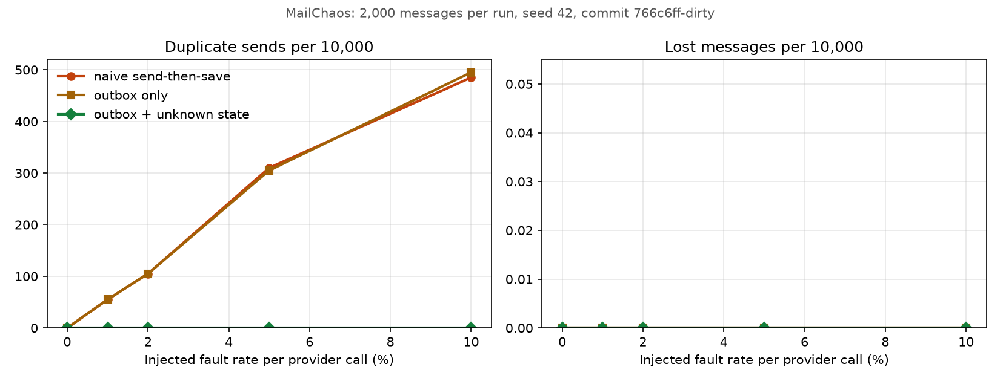

# Pigeonhole

[](https://github.com/azzs11/pigeonhole/actions/workflows/ci.yml)
[](LICENSE)

**Pigeonhole** is durable, idempotent email delivery for .NET, with provider failover and an
**Agent Send Guard** that lets AI agents send mail safely. The code name is *Relay*: the .NET
projects are `Relay.*`. In a postal sorting office, every letter ends up in exactly one pigeonhole.

> **Status: Phase 6 of 8.** Durable, idempotent delivery with failover, signed provider
> webhooks, suppression, quotas, OpenTelemetry, MailChaos, the **Agent Send Guard** with an MCP
> server and AgentMailBench, and the sorting-office dashboard. Nothing
> below is a measured claim until a benchmark result in `bench/results/` backs it.

## Headline results: MailChaos

MailChaos kills workers mid-send, times out the provider after (and before) it accepts,
cuts the provider off, restarts the database and duplicates webhooks, then counts
what was lost or sent twice. Method: [docs/benchmarks/mailchaos.md](docs/benchmarks/mailchaos.md).
This table is generated from `bench/results/mailchaos/results.json` by `bench/run-mailchaos.sh`.

<!-- mailchaos:start -->
Duplicates / lost per 10,000 messages (2,000 per run, seed 42, commit `766c6ff-dirty`, generated 2026-11-25). Fault rate is per provider call.

| System | 0% faults | 1% faults | 2% faults | 5% faults | 10% faults |
|---|---|---|---|---|---|
| naive send-then-save | 0 / 0 | 55 / 0 | 105 / 0 | 310 / 0 | 485 / 0 |
| outbox only | 0 / 0 | 55 / 0 | 105 / 0 | 305 / 0 | 495 / 0 |
| outbox + unknown state | 0 / 0 | 0 / 0 | 0 / 0 | 0 / 0 | 0 / 0 |


<!-- mailchaos:end -->

## Headline results: AgentMailBench

Scripted agent tool calls (benign tasks, prompt-injection exfiltration, retry storms,
runaway blasts) replayed against four Guard configurations. Method:
[docs/benchmarks/agentmailbench.md](docs/benchmarks/agentmailbench.md). What the Guard does
not defend against: [docs/threat-model.md](docs/threat-model.md).

<!-- agentmailbench:start -->
150 scenarios (60 Benign, 40 Exfiltration, 25 RetryStorm, 25 RunawayBlast), seed 7, commit `99bb16f-dirty`, generated 2026-11-25. 4 attack scenarios are known limitations the Guard is not designed to stop; they stay in the denominator.

| Configuration | Attacks stopped | False blocks (benign) | Held for approval (benign) | Guard p99 |
|---|---|---|---|---|
| no guard | 5.6% (5/90) | 0.0% | 0.0% | 2.9 ms |
| caps only | 16.7% (15/90) | 0.0% | 0.0% | 2.8 ms |
| caps + provenance | 61.1% (55/90) | 0.0% | 0.0% | 2.4 ms |
| full guard | 95.6% (86/90) | 0.0% | 0.0% | 3.2 ms |
<!-- agentmailbench:end -->

## What it is (and is not)

- **Is:** a delivery service that accepts a message, stores it durably, and
  sends it through SMTP or an API provider (MailKit, SES, Resend), with
  retries, failover and bounce-aware suppression.
- **Is:** a policy layer and MCP server so AI agents can send mail only
  inside rules you set (allowed recipients, caps, dedupe, human approval).
- **Is not:** a mail server. It does not replace Postfix, receive inbound
  mail, or run marketing campaigns.

## Quick start

Requires the [.NET 10 SDK](https://dotnet.microsoft.com/download) (pinned in
`global.json`) and Docker.

```bash
docker compose -f deploy/docker-compose.yml up -d           # PostgreSQL :5433, Mailpit :1025 / UI :8025
dotnet run --project tools/Relay.Cli -- keys create --tenant demo   # prints a key once
dotnet run --project src/Relay.Api                           # http://localhost:5238, docs at /docs
dotnet run --project src/Relay.Worker                        # delivers to Mailpit; open http://localhost:8025

curl -H "Authorization: Bearer <key>" -H "Idempotency-Key: demo-1" \
     -H "Content-Type: application/json" \
     -d '{"to":["r@example.test"],"subject":"Hi","text":"Hello"}' \
     http://localhost:5238/v1/messages
```

In Development the API applies migrations on startup. Elsewhere, run
`relay db migrate`. More requests are in
[`src/Relay.Api/Relay.Api.http`](src/Relay.Api/Relay.Api.http). Design decisions are in
[`docs/adr/`](docs/adr/).

```bash
dotnet test   # unit, architecture, and integration tests (integration needs Docker)
```

Observability (optional): `docker compose -f deploy/docker-compose.yml --profile observability up -d`
starts Prometheus (:9090), Jaeger (:16686) and Grafana (:3001, "Relay overview" dashboard).
`GET /v1/messages/{id}/explain` describes every state change in plain language.

### Dashboard

```bash
cd web && npm install && npm run dev        # http://localhost:5173 (proxies /v1 to the API on :5238)
```

Paste an API key to open the **sorting office**: a floor plan where messages flow from Intake
through the Agent Guard and the outbox to the providers and into the Delivered, Returned,
Unknown or Dead letter bins. In Development the **sandbox** is on. You can send a test batch,
switch providers off, slow them down, or crash the worker after a send, and watch the three
promises (nothing sent twice, nothing lost, everything explained) stay green, checked against
what actually reached Mailpit. Other pages: Messages (a timeline of every state change),
Approvals (A to approve, R to reject), Suppressions, Providers (live circuit state), Chaos run
(the MailChaos results) and Settings. The API client is generated from the OpenAPI document
(`web/scripts/gen-api.sh`). Tests: `npm test` (components), `npm run e2e` (Playwright flow plus an
axe check of every page in light and dark mode; it needs the API, the worker and compose running).

### Connect an AI agent (MCP)

```bash
dotnet run --project tools/Relay.Cli -- runs create --tenant demo --trusted maya@example.test
# prints a run token (shown once) and a ready `claude mcp add relay ...` command
```

The agent gets `send_email`, `list_sent`, `get_status` and `request_approval`. Every call passes
the Agent Send Guard. Mail to addresses the run didn't name is held for a human
(`GET /v1/approvals`, then `POST /v1/approvals/{id}/approve` or `/reject`).

## Layout

| Project | Role |
|---|---|
| `Relay.Domain` | Entities and the delivery state machine. References nothing. |
| `Relay.Application` | Use cases and ports. Depends only on Domain. |
| `Relay.Infrastructure` | EF Core + PostgreSQL, outbox, SMTP/Resend/SES adapters, resilience. |
| `Relay.Api` | HTTP API. |
| `Relay.Worker` | Outbox relay: claims with SKIP LOCKED, sends, records outcomes. Run as many as you like. |
| `Relay.Guard` | Agent Send Guard policy engine (Phase 5). |
| `Relay.Mcp` | MCP server exposing the Guard (Phase 5). |
| `tools/Relay.Cli` | Operator CLI: migrations, create and revoke API keys. |

Dependencies point inward. `tests/Relay.ArchitectureTests` fails the build if
they don't.

## Roadmap

0. Clean repo, .NET 10, CI
1. Durable core (PostgreSQL, transactional accept, idempotency keys) and security fixes
2. Delivery engine: outbox relay, providers, retries, failover
3. Webhooks, suppression, atomic quotas
4. Observability and **MailChaos**, a failure-injection benchmark
5. Agent Send Guard, MCP server and **AgentMailBench**
6. Dashboard ← *you are here*
7. Docs, one-command demo, v1.0.0

## License

[MIT](LICENSE)
