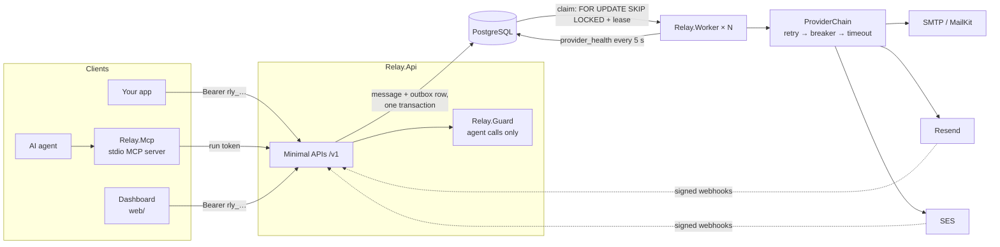

# Architecture

Pigeonhole (code name Relay) has one job: take a message, keep it safe, and get it to a
provider **once**. This page covers the moving parts. The *why* behind each choice is in
[`adr/`](adr/).

## The pieces

| Project | Owns | Depends on |
|---|---|---|
| `Relay.Domain` | `Message` and its state machine (`Message.Transition`), `Tenant`, `ApiKey`, `Suppression` | nothing |
| `Relay.Application` | Use cases (accept, bulk, explain), ports, options, `RelayTelemetry` | Domain |
| `Relay.Guard` | `GuardEvaluator` (pure), `SecretScanner`, `ContentFingerprint`, `AgentGuardService` | Application |
| `Relay.Infrastructure` | EF Core, outbox, claimer, delivery engine, provider adapters, webhooks, sandbox, observability | Application, Guard |
| `Relay.Api` | HTTP endpoints, auth, rate limits, ProblemDetails | Infrastructure |
| `Relay.Worker` | Hosted services: outbox relay and metrics snapshots | Infrastructure |
| `Relay.Mcp` | Thin MCP client: every check happens in the API | (HTTP only) |
| `tools/Relay.Cli` | Migrations, keys, agent runs, tenant quota and pause | Infrastructure |

`tests/Relay.ArchitectureTests` (NetArchTest) fails the build if a dependency points outward.

## The life of a message

1. **Accept.** `POST /v1/messages` validates the message (addresses, CR/LF, sizes), checks
   suppressions, charges the tenant's daily quota with one atomic `UPDATE … WHERE used + n <=
   limit`, and writes the message, its first event and an outbox row **in one transaction**. The
   `Idempotency-Key` is unique per tenant, so a retried request returns the original message.
2. **Claim.** Workers poll the outbox with `FOR UPDATE SKIP LOCKED`, set a lease (`locked_by`,
   `locked_until`) and commit **Sending** *before* calling a provider. Any number of workers can
   run; they never take the same row.
3. **Send.** `ProviderChain` tries providers in the configured order. Each has its own Polly
   pipeline: retry (Transient only), circuit breaker, timeout. Adapters return a classified
   outcome rather than throwing:

   | Outcome | Meaning | What happens |
   |---|---|---|
   | Sent | Provider accepted it | → Sent |
   | Transient | Definitely not sent | Next provider, or back to Accepted with backoff |
   | Rejected | Not sent, retrying won't help | → DeadLettered |
   | Unknown | May have been sent (timeout, crash after the call) | → Unknown; **never** fails over |

4. **Reconcile.** Unknown messages on a provider that deduplicates (Resend) are retried on that
   provider only. Others follow `Relay:Delivery:UnknownOutcome` (`Hold` by default, or
   `RetryAfterWindow`). A lease that expires while a message is still Sending also produces
   Unknown, not a resend.
5. **Feedback.** Provider webhooks (Resend: Svix signature; SES: SNS signature) become
   `DeliveryEvent`s. `DeliveryEventProcessor` applies each one **exactly once**, using a unique
   `provider_events` row inserted in the same transaction as the state change. Hard bounces and
   complaints add suppressions, and `ReputationGuard` pauses a tenant whose bounce or complaint
   rate crosses its threshold.

Every message has a deterministic `Message-ID` (`<{id}@{domain}>`) that stays the same across
attempts and providers. That's how a late webhook finds its letter.

## Agent sends

An operator starts a run (`POST /v1/agent-runs`, scope `agents:manage`), naming trusted
recipients and allowed domains. The agent gets a run token that can only call `/v1/agent/*`.
Each call is scored by `GuardEvaluator` on caps, recipient provenance, secret and PII scan, and
near-duplicate fingerprint. The result is **Send**, **Hold** (waits in `/v1/approvals`) or
**Block**. The run token can never approve. See [threat-model.md](threat-model.md).

## Sandbox

`Relay:Sandbox:Enabled` turns on:

- the fault switches (provider off, slow, crash after accept), applied by an `IProviderInterceptor`;
- test batches, simulated bounces and the live promises check;
- `POST /v1/sandbox/demo-key`, which creates a throwaway tenant with a small quota. It is
  limited per client IP; behind the dashboard's nginx the IP comes from `X-Forwarded-For`,
  trusted only from `Relay:Proxy:KnownNetworks`.

`SandboxOptions.EnsureSinkOnly` stops the worker from starting in sandbox mode with an API
provider. The compose stack points its single SMTP provider at Mailpit.

## Observability

One `ActivitySource` and one `Meter` (`RelayTelemetry`). The trace continues from the API to
the worker through `outbox.trace_parent`. Serilog writes JSON with masked addresses.
`docker compose -f deploy/docker-compose.yml --profile observability up -d` adds Prometheus,
Jaeger and Grafana. `GET /v1/messages/{id}/explain` turns a message's events into sentences.

## Deployment shape

`docker compose up` (root `compose.yaml`) runs PostgreSQL, Mailpit, the API, one worker and the
dashboard. nginx serves the static build and proxies `/v1`, `/docs` and `/openapi` to the API,
so there is no CORS and the API port is not published. Release images (API, worker, dashboard)
are built, pushed to GHCR and signed with cosign by `.github/workflows/release.yml`.
